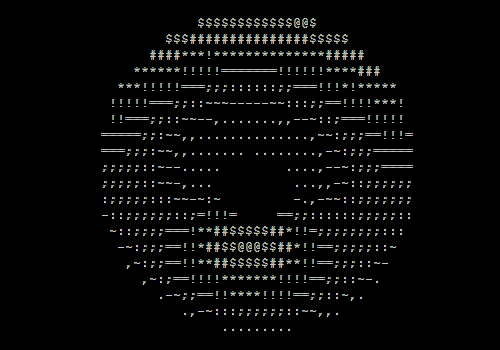

Hi there! I'm Shreyansh Singh
================================

**Software Developer & Cybersecurity Learner**  
I build things, then learn how to break them, so what I ship holds up.

First-year **B.Tech CSE** student  
Coding since 9th grade, now turning that habit into real desktop apps, web apps and AI experiments

  

What I do
-----------

- Build desktop and web projects in **C++**, **JavaScript**, **React** and **Electron**
- Explore **Java**, **Go** and **machine learning with PyTorch**
- Practice **DSA** to build strong core computer science fundamentals

What I'm exploring
--------------------

- Network security, password hashing and log analysis
- How systems get attacked, and how to defend them

Tags
-------

B.Tech CSE student · C++ developer · Java · Go (Golang) · Machine Learning with PyTorch · JavaScript, React.js & Electron learner · Cybersecurity enthusiast · Desktop & web projects · DSA & LeetCode · VS Code · Git · GitHub

Tech & Tools
----------------

OS & Security
----------------

IDEs & Tools
---------------

What I'm doing right now
---------------------------

- Learning C++ as my main language for DSA and core computer science.
- Building desktop and web projects in C++ and JavaScript to understand real-world workflows.
- Exploring Java, Go, React.js and machine learning with PyTorch alongside my core languages.
- Exploring cybersecurity basics (network security, password hashing, log analysis) as a student learner.

Projects & Repositories
--------------------------

I keep most of my work public to track my progress and share what I'm learning:

- [`C_plus_plus__projects`](https://github.com/Shreyansh-DevHub/C_plus_plus__projects) – C++ practice projects and mini apps.
- [`JavaScript`](https://github.com/Shreyansh-DevHub/JavaScript) – small JS apps and experiments as I learn frontend and basic logic.
- [`Python`](https://github.com/Shreyansh-DevHub/Python) – 10 small Tkinter GUI apps, including a folder organizer and a Pomodoro timer.
- [`Machine_Learning`](https://github.com/Shreyansh-DevHub/Machine_Learning) – machine learning practice projects and experiments.
- [`Java`](https://github.com/Shreyansh-DevHub/Java) – core Java learning roadmap and beginner projects.
- [`GoLang`](https://github.com/Shreyansh-DevHub/GoLang) – Go fundamentals and practice code.
- [`CyberSecurity`](https://github.com/Shreyansh-DevHub/CyberSecurity) – CompTIA Network+ and Security+ notes plus hands-on Python projects.
- [`My_Coding_Journey`](https://github.com/Shreyansh-DevHub/My_Coding_Journey) – where it started: my early code from Grade 9 and Grade 10.

As I improve, I'm turning these into more polished, documented projects with clearer READMEs and screenshots.

Featured Projects
--------------------

* **[AI-HAR On-board BAS Experiment](https://github.com/Shreyansh-DevHub/AI-HAR-_On-board_BAS_Experiment)**

* **[ROOTED Farm Analysis App](https://github.com/Shreyansh-DevHub/ROOTED-farm-analysis-app)**

* **[Lotus Management Project](https://github.com/Shreyansh-DevHub/lotus-management-project)**

Goals
--------

- Build a strong foundation in C++ and DSA during my first year of college and beyond.
- Use JavaScript and Electron for personal productivity tools and small desktop apps.
- Ship one polished security project, then grow into deeper cybersecurity work.

Connect with Me
------------------

